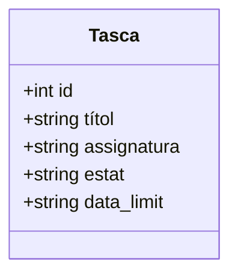

# SPECIFICATIONS.md — Sistema Tasks_app (v1.0)

## 1. Visió General
Tasks_app és una eina CLI lleugera per ajudar als estudiants a gestionar les seves tasques acadèmiques diàries.

## 2. User Stories (Històries d'Usuari)
- US-01: Com a estudiant, vull afegir una tasca amb títol i assignatura per recordar els meus deures.
- US-02: Com a estudiant, vull veure la llista de tasques pendents per organitzar el meu temps.
- US-03: Com a estudiant, vull indicar una data límit en crear una tasca per controlar quan l'he de lliurar.
- US-04: Com a estudiant, vull poder modificar qualsevol atribut d'una tasca existent per corregir errors de registre.
- US-05: Com a estudiant, vull marcar una tasca com a completada per portar un control real de la feina feta.
- US-06: Com a estudiant, vull veure avisos visuals a la llista quan una tasca estigui caducada o a punt de vèncer per prioritzar les meves entregues.

## 3. Model de Dades (Mermaid)

## 4. Requisits
- RF-01 : El sistema tasks_app ha de guardar les tasques en un fitxer JSON de persistència local.
- RF-02 : Si el fitxer `data/tasks.json` no existeix, el sistema tasks_app ha de crear `data/tasks.json`  inicialitzat amb una llista JSON buida ([])
- RF-03 : El sistema tasks_app ha de proveir a l'estudiant la capacitat de crear una nova tasca amb estat 'pendent' mitjançant el comandament add --title <títol> --subject <assignatura>.
- RF-04: El sistema tasks_app ha de proveir a l’estudiant la capacitat de visualitzar totes les tasques registrades (incloent-hi el seu ID, títol, assignatura i estat) mitjançant el comandament list.
- RF-05: El sistema tasks_app ha de proveir a l'estudiant la capacitat d'assignar opcionalment una data límit en format `YYYY-MM-DD` en crear una tasca mitjançant el paràmetre `--due <YYYY-MM-DD>` al comandament `add` (emmagatzemant `null` si no s'indica).
- RF-06: Si la data introduïda al paràmetre `--due` no segueix el format vàlid `YYYY-MM-DD`, el sistema tasks_app ha de rebutjar l'operació i mostrar un missatge d'error descriptiu sense desar la tasca.
- RF-07: El sistema tasks_app ha de proveir a l'estudiant la capacitat de modificar qualsevol atribut (títol, assignatura, estat o data límit) d'una tasca existent identificada pel seu ID mitjançant el comandament `edit --id <ID> [--title <títol>] [--subject <assignatura>] [--status <estat>] [--due <YYYY-MM-DD>]`.
- RF-08: Si l'identificador `--id <ID>` indicat als comandaments `edit` o `complete` no existeix al registre, el sistema tasks_app ha de mostrar el missatge d'error `Error: No s'ha trobat cap tasca amb ID <ID>`.
- RF-09: El sistema tasks_app ha de proveir a l'estudiant la capacitat de marcar una tasca existent com a `'completada'` mitjançant el comandament `complete --id <ID>`.
- RF-10: Si una tasca amb estat `'pendent'` té una data límit estrictament anterior al dia actual, el sistema tasks_app ha de mostrar l'etiqueta `[CADUCADA]` al final de la seva línia en executar el comandament `list`.
- RF-11: Si una tasca amb estat `'pendent'` té una data límit igual o posterior al dia actual i a menys de 7 dies vista (diferència de 0 a 6 dies), el sistema tasks_app ha de mostrar l'etiqueta `[URGENT]` al final de la seva línia en executar el comandament `list`.

## 5. Criteris d’acceptació i proves (Gherkin scenarios)
- GS-01: Creació correcta d'una tasca
  Atès que la base de dades JSON no conté encara tasques
  quan l’estudiant executa `python src/tasks_app.py add --title 'Pràctica 1' --subject 'RS'
  aleshores el sistema confirma `Tasca [ID: 1] creada amb èxit`
  i la tasca queda registrada al fitxer `data/tasks.json`.

- GS-02: Llistat de tasques quan `data/tasks.json` no conté registres 
  Atès que la base de dades JSON no conté encara tasques
  quan l’estudiant executa `python src/tasks_app.py list`
  aleshores el sistema mostra `Registre de tasques buit.` 

- GS-03: Llistat de tasques quan data/tasks.json conté registres
  Atès que el fitxer `data/tasks.json` conté les següents tasques:
    | id | títol          | assignatura | estat   |
    | 1  | Pràctica 1     | RS          | pendent |
    | 2  | Examen parcial | SO          | pendent |
  quan l’estudiant executa `python src/tasks_app.py list`
  aleshores el sistema mostra per pantalla:
    "[1] Pràctica 1 (RS) - estat: pendent"
    "[2] Examen parcial (SO) - estat: pendent"
    
- GS-04: Creació d'una tasca amb data límit vàlida
  Atès que la base de dades JSON està buida
  quan l'estudiant executa `python3 src/tasks_app.py add --title 'Lliurament SDD' --subject 'RS' --due 2026-12-02`
  aleshores el sistema confirma `Tasca [ID: 1] creada amb èxit`
  i la tasca queda desada amb `data_limit: "2026-12-02"`.

- GS-05: Edició dels atributs d'una tasca existent
  Atès que existeix la tasca amb ID 1 (`títol: "Pràctica 1"`, `assignatura: "RS"`, `estat: "pendent"`, `data_limit: null`)
  quan l'estudiant executa `python3 src/tasks_app.py edit --id 1 --title 'Pràctica 1 Refinada' --due 2026-12-10`
  aleshores el sistema confirma `Tasca [ID: 1] actualitzada amb èxit`
  i els nous valors queden persistits a `data/tasks.json`.

- GS-06: Error en intentar editar una tasca inexistent
  Atès que no existeix cap tasca amb ID 99
  quan l'estudiant executa `python3 src/tasks_app.py edit --id 99 --title 'Nova'`
  aleshores el sistema mostra `Error: No s'ha trobat cap tasca amb ID 99`.

- GS-07: Marcar una tasca com a completada
  Atès que existeix la tasca amb ID 1 amb estat `'pendent'`
  quan l'estudiant executa `python3 src/tasks_app.py complete --id 1`
  aleshores el sistema confirma `Tasca [ID: 1] marcada com a completada`
  i el seu estat passa a `'completada'` a `data/tasks.json`.

- GS-08: Llistat amb etiquetes d'avís `[CADUCADA]` i `[URGENT]`
  Atès que la data actual del sistema és `2026-11-23` i el fitxer `data/tasks.json` conté:
    | id | títol            | assignatura | estat      | data_limit |
    | 1  | Tasca antiga     | RS          | pendent    | 2026-11-20 |
    | 2  | Tasca propera    | SO          | pendent    | 2026-11-27 |
    | 3  | Tasca llunyana   | BD          | pendent    | 2026-12-15 |
    | 4  | Tasca ja feta    | RS          | completada | 2026-11-18 |
  quan l'estudiant executa `python3 src/tasks_app.py list`
  aleshores el sistema mostra per pantalla:
    "[1] Tasca antiga (RS) - estat: pendent - límit: 2026-11-20 [CADUCADA]"
    "[2] Tasca propera (SO) - estat: pendent - límit: 2026-11-27 [URGENT]"
    "[3] Tasca llunyana (BD) - estat: pendent - límit: 2026-12-15"
    "[4] Tasca ja feta (RS) - estat: completada - límit: 2026-11-18"